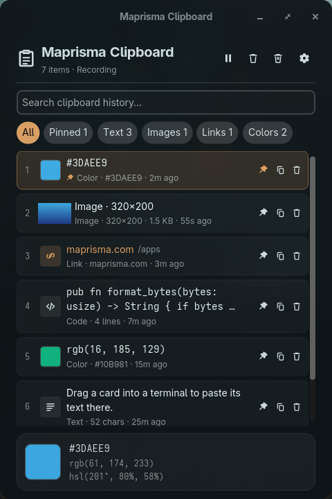
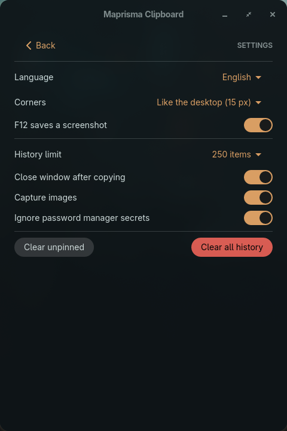

<p align="center">
  
</p>

# Maprisma Clipboard

Fast, local, privacy-first **Wayland clipboard manager** in pure Rust (`libcosmic` + `zbus` StatusNotifierItem) for **COSMIC**, **KDE Plasma 6**, and **Hyprland**.

<p align="center">
  
  
</p>

## Highlights

- **Event-driven Wayland capture** — uses `wl-paste --watch` + `wl-clipboard-rs` (with automatic fallback) for zero-polling capture of text, code, links, CSS colors, emails, and images (PNG/JPEG/WebP).
- **Smart content classification & rich previews** — live **color swatches** (`#RGB`, `#RRGGBB`, `rgb()`, `rgba()`, `hsl()` with HEX/RGB/HSL inspector), crisp **image thumbnails**, monospace **code & JSON** previews, and **URL domain badges** with one-click *Open URL*.
- **Pinning & SHA-256 deduplication** — pinned clips stay on top, survive *Clear unpinned*, and are never pruned by the history limit. Re-copying moves existing clips to the top without duplicates.
- **Privacy by default** — stored locally with `0600` permissions in `~/.local/share/maprisma-clipboard/`, ignores password manager secrets (`x-kde-passwordManagerHint` / `application/x-keepassxc-secret`), and supports one-click **Pause / Resume** from the header or tray icon.
- **Keyboard-first workflow** — instant search focus, `↑`/`↓` navigation, `Enter` copy, `Shift+Enter` copy plain single-line text, `Ctrl+1`..`Ctrl+9` quick copy, `Ctrl+P` pin, `Delete` remove with 5-second **Undo**, `Esc` close, `F12` private screenshot.
- **Drag & drop out** — drag a clip's card into a terminal, editor or file manager: text clips drop as plain text, images as the picture or its file.
- **Clean cards** — pin, copy and delete live on each card; the header has *Clear unpinned* and *Clear all history* symbols, and the window remembers its size and (on Hyprland) its position as soon as you resize or move it.
- **First-run `cliphist` import** — automatically imports up to 50 recent entries from `cliphist` when starting fresh.
- **Desktop-native look & 8 languages** — follows your COSMIC, KDE, or Hyprland/Maprisma Theme colors, fonts, text scale, and corner radius, with built-in English, Deutsch, Français, Español, Italiano, Português, Nederlands, and Polski.

## Install

```bash
git clone https://github.com/maprisma/clipboard.git
cd clipboard
chmod +x install.sh
./install.sh
```

This installs:
- `~/.local/bin/maprisma-clipboard` (standalone toggle window + COSMIC panel applet)
- `~/.local/bin/maprisma-clipboard-tray` (KDE / Hyprland StatusNotifierItem bar icon & background watcher)
- Desktop entries in `~/.local/share/applications/` and autostart in `~/.config/autostart/`

### Keybindings (Hyprland / KDE)

- `maprisma-clipboard` (or `maprisma-clipboard --window`): opens or toggles the clipboard window
- `maprisma-clipboard -d`: opens in delete mode (`Enter` removes the selected clip with Undo)
- `maprisma-clipboard --applet`: runs in COSMIC panel applet mode (also auto-detected inside `cosmic-panel`)

## License

MIT — Copyright (c) 2026 uBruckhaus
